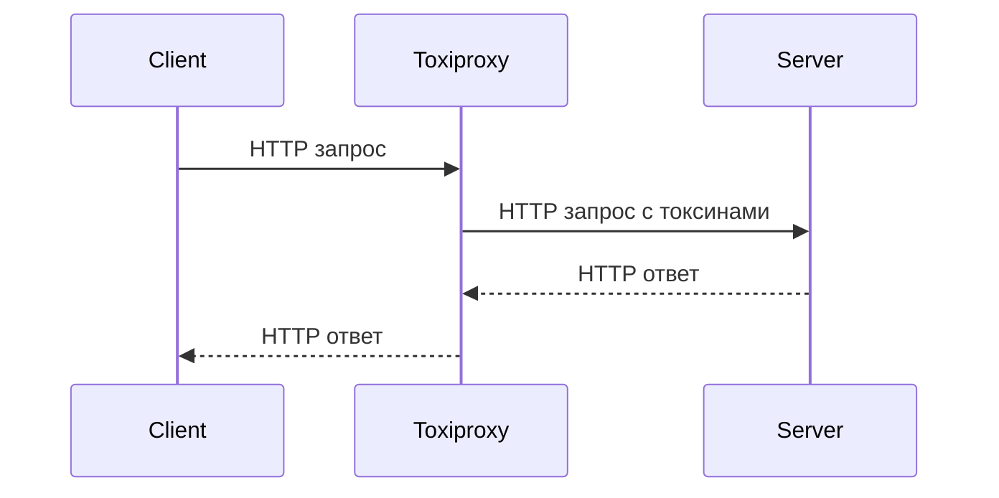

# Тестирование отказоустойчивости Go-приложений с помощью Toxiproxy и проверка паттернов защиты (Retry, Circuit Breaker, Timeout, Bulkhead, Rate Limiting)    

Проект показывает, как проверить устойчивость Go-приложения к сетевым сбоям с помощью [Toxiproxy](https://github.com/Shopify/toxiproxy), и как пять паттернов защиты реагируют на эти сбои.

## Содержание

- [Что внутри](#что-внутри)
- [Схема](#схема)
- [Требования](#требования)
- [Быстрый старт](#быстрый-старт)
- [Сценарии](#сценарии)
- [Паттерны и токсины](#паттерны-и-токсины)
- [Результаты](#результаты)
- [Структура проекта](#структура-проекта)
- [Конфигурация](#конфигурация)
- [Тезисы для доклада](#тезисы-для-доклада)
- [Ограничения](#ограничения)

## Что внутри

- **Toxiproxy** — TCP-прокси, который вносит сбои: `latency`, `reset_peer`, `timeout`, `bandwidth`, `slow_close`.
- **Пять паттернов защиты** (`internal/patterns/`): Retry, Timeout, CircuitBreaker, Bulkhead, RateLimiter.
- **HTTP-клиент** (`internal/client/`) — композиция паттернов через цепочку middleware.
- **HTTP-сервер** (`internal/server/`) — upstream с эндпоинтами `/fast`, `/slow`, `/error`, `/random`, `/heavy`, `/health`. Плюс серверные middleware: RateLimit, Bulkhead, Timeout.
- **Раннер сценариев** (`internal/runner/`) — читает JSON-сценарий, ставит токсины, гонит нагрузку, собирает метрики в CSV.

## Схема



## Требования

- Go 1.22+
- Docker и docker compose
- Toxiproxy (поднимается через docker compose)

## Быстрый старт

### 1. Поднять Toxiproxy

```bash
docker compose up -d toxiproxy
```

Toxiproxy слушает API на `:8474`, прокси — на `:8666`.

### 2. Запустить сервер

```bash
go run cmd/server/main.go
```

Сервер поднимется на `:8080`, эндпоинты: `/fast`, `/slow`, `/error`, `/random`, `/heavy`, `/health`.

### 3. Прогнать сценарий

```bash
go run cmd/runner/main.go -scenario test_cb
```

Раннер создаст прокси в Toxiproxy, применит токсины, погонит нагрузку и сохранит результат в `results/`.

### 4. Посмотреть результат

```bash
cat results/test_cb_*.csv
```

Файл с метриками: `step`, `success`, `failed`, `p50/p95/p99`    

### 5. Остановить Toxiproxy

```bash
docker compose down
```

### Альтернатива через Makefile

```bash
make up                          # поднять toxiproxy
make run SCENARIO=test_timeout   # прогнать сценарий
make down                        # остановить
```

## Сценарии

Сценарии описываются в JSON-файлах в `scenarios/`.

Пример сценария:

```json
{
  "name": "test_timeout",
  "proxy_name": "test_timeout",
  "server_url": "http://host.docker.internal:8080",
  "warmup_s": 2,
  "middlewares": ["timeout"],
  "steps": [
    { "duration_s": 5, "rps": 30, "endpoint": "/fast", "toxic": null },
    { "duration_s": 10, "rps": 30, "endpoint": "/fast", "toxic": { "type": "latency", "latency_ms": 2000, "jitter_ms": 1000 } }
  ]
}
```

## Паттерны и токсины

| Паттерн          | Описание                                                                                     |
|------------------|---------------------------------------------------------------------------------------------|
| Retry            | Повторяет запрос при ошибках с экспоненциальной задержкой и джиттером.                     |
| Timeout          | Отменяет запрос, если он выполняется дольше указанного времени.                             |
| CircuitBreaker   | Отключает запросы к серверу, если он не отвечает в течение указанного времени.              |
| Bulkhead         | Ограничивает количество одновременных запросов к серверу.                                    |
| RateLimiter      | Ограничивает количество запросов в секунду.                                                 |


| Токсин            | Описание                                                                                     |
|------------------|---------------------------------------------------------------------------------------------|
| latency          | Добавляет задержку к запросам.                                                              |
| timeout          | Отменяет запрос после указанного времени.                                                  |
| reset_peer       | Сбрасывает соединение с сервером.                                                           |
| bandwidth        | Ограничивает пропускную способность соединения.                                             |
| slow_close       | Закрывает соединение медленно, чтобы протестировать обработку неожиданного закрытия.       |

## Результаты

Результаты сохраняются в CSV-файлы в `results/`.

Пример CSV:

| step | duration_s | rps | toxic | total | success | failed | retries | p50_ms | p95_ms | p99_ms | avg_ms | cb_closed | cb_open | cb_half_open |
|---|---|---|---|---|---|---|---|---|---|---|---|---|---|---|
| 1 | 5 | 30 | - | 150 | 150 | 0 | 0 | 10.0 | 20.0 | 30.0 | 15.0 | 150 | 0 | 0 |
| 2 | 10 | 30 | latency | 300 | 250 | 50 | 10 | 200.0 | 300.0 | 400.0 | 250.0 | 250 | 50 | 0 |

## Структура проекта

```bash
pr4/
├── cmd/
│   ├── runner/
│   │   └── main.go
│   └── server/
│       └── main.go
├── configs/
│   └── .env
├── internal/
│   ├── client/
│   ├── config/
│   ├── patterns/
│   ├── runner/
│   ├── server/
│   └── toxiproxy/
├── scenarios/
│   ├── server_overload.json
│   ├── stepwise_degradation.json
│   ├── test_bulkhead.json
│   ├── test_cb.json
│   ├── test_ratelimit.json
│   ├── test_retry.json
│   └── test_timeout.json
├── results/
├── go.mod
├── go.sum
└── README.md
```

## Конфигурация

Конфигурация задаётся в `configs/.env`.

Пример конфигурации:

```env
# Toxiproxy
TOXIPROXY_HOST=localhost
TOXIPROXY_API_PORT=8474
TOXIPROXY_PROXY_PORT=8666

# Retry
RETRY_MAX_ATTEMPTS=3
RETRY_INITIAL_DELAY=100ms
RETRY_MAX_DELAY=5s
RETRY_MULTIPLIER=2.0
RETRY_JITTER=true

# Circuit Breaker
CB_THRESHOLD=3
CB_HALF_OPEN_SUCCESS=2
CB_TIMEOUT=5s

# Timeout
TIMEOUT_DEFAULT=1s

# Bulkhead
BULKHEAD_MAX_CONCURRENT=5

# Rate Limiter
RATE_LIMIT_RPS=10
RATE_LIMIT_BURST=20

# Log
LOG_LEVEL=info
LOG_FORMAT=text

# Server
SERVER_HOST=0.0.0.0
SERVER_PORT=8080
SERVER_DEFAULT_SLOW_MS=500
SERVER_DEFAULT_ERROR_RATE=0.3
SERVER_MIDDLEWARE=false
SERVER_RATE_LIMIT_RPS=100
SERVER_RATE_LIMIT_BURST=200
SERVER_BULKHEAD_MAX=50
SERVER_BULKHEAD_WAIT=100ms
SERVER_REQUEST_TIMEOUT=5s

# Runner
RUNNER_SCENARIOS_DIR=scenarios
RUNNER_RESULTS_DIR=results
RUNNER_FIXTURES_DIR=fixtures
```

## Тезисы

1. **Toxiproxy** — мощный инструмент для тестирования отказоустойчивости.
2. **Паттерны защиты** — важный инструмент для повышения устойчивости приложений.
3. **Композиция паттернов** — позволяет гибко настраивать защиту приложения.
4. **Сценарии тестирования** — позволяют автоматизировать тестирование отказоустойчивости.
5. **Метрики** — помогают оценить эффективность паттернов защиты.

## Ограничения

- Toxiproxy работает только с TCP-соединениями.
- Паттерны защиты работают только с HTTP-запросами.
- Сценарии тестирования должны быть описаны в JSON-файлах.
- Результаты тестирования сохраняются в CSV-файлах.
